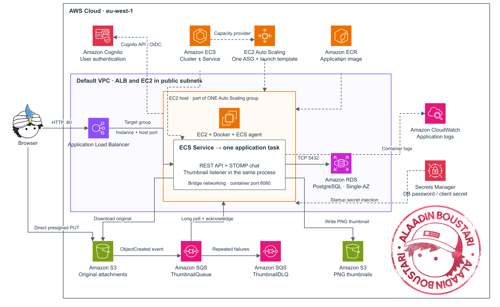
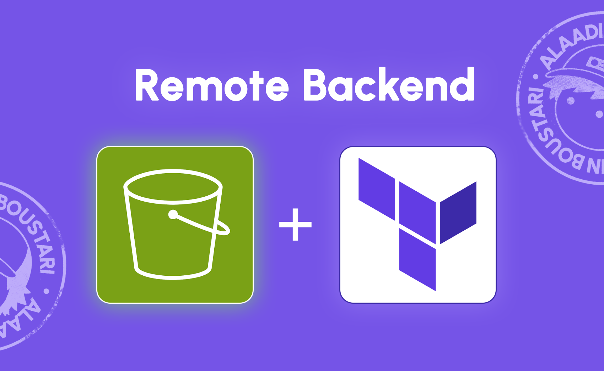

# AUTH

## Backend-for-Frontend inspired architecture : AWS_COGNITO

*Authentication with Cognito + Spring Security*

> The idea was to replace the DAO authentication with **Amazon Cognito**, but it quickly spiraled into debugging and reading Java documentation :(

The app has two different login methods: fully managed by AWS and a custom login backed by the Cognito API.

The BFF architecture is a security pattern where the server-side (SpringBoot in our case) handles token negotiation, expiry and validation on behalf of the client. This is achieved by letting the client store HttpOnly Cookies and send them to the server on each request. This prevents frontend JavaScript from reading the authentication cookies. Greatly limiting Cross-Site Scripting.

---
# ATTACHMENT PROCESSING

# Claim Check Integration Pattern

*Storage and processing with S3 and SQS*

> The idea was to decouple image storage and thumbnail generation by employing S3 and SQS + DLQ.

Claim Check is an integration pattern used to handle large payloads over lightweight message queues (for example, SQS tops at 1 MiB). So, instead of passing a massive payload directly through a message queue, the system stores the full thing in an external data store and sends only a small reference, the **claim check**, through the message broker.

In our case, we store the message’s attachment in S3 and send an **“All object create events”** notification to SQS containing the bucket name and object key. Our Java worker “long-polls” the queue using Spring Cloud AWS, produces a thumbnail using Thumbnailator, updates the DB, and passes the acknowledgement so the queue can safely remove the message instead of passing it to the dead-letter queue.

---

# DEPLOYMENT 

The  setup used **Amazon ECS on self-managed EC2 instances**, **bridge networking**, an **Application Load Balancer**, and **RDS PostgreSQL**.NOt Fargate or ECS Managed Instances.

the ASG maintained the **EC2s** while the ECS Service maintained **tasks**.

## Networking: how the request reached the container

The deployment reused the default VPC and its subnets ( ma kansh fia may gad route tables hhh ) The internet facing ALB and EC2 hosts used public subnets. RDS was reached using its private address inside the VPC

The final task used **bridge** networking

The target group used **Instances** for this bridge setup. The ALB health check used `/login.html`

With bridge networking, the task used the host's networking and SG rules.

---

# IaC REMOTE BACKEND

Clicking around in the console was tedious for this simple project and a week later I already forgot what was running and where I needed to click. In a bigger environment with other people working alongside me this would probably be a nightmare.

The cloud’s solution for this problem is **Terraform**. A declarative infra as code tool to provision your resources using HCL language to define the end state of what you want and they make the API calls for you :D.

## Managing Shared State

While convenient, a very obvious problem will rise and that is shared state conflicts between terraform users. A widely known and **CHEAP** method is to Bootstrap using an S3 bucket with: Versioning + state-Lock + encryption **AND** public access block + lifecycle protection from deletion ( majority are defaults of S3)

This ensures everyone has one source of truth that won’t allow 2 applies to run at the same time or deletion of that Bucket through `terraform destroy`.

## Modular Architecture

The current projects uses a **MODULAR** structure instead of one big `.TF` file. Terraform handles this facilement by drawing a neat Dependency Graph to map out resources and orders of creation.

