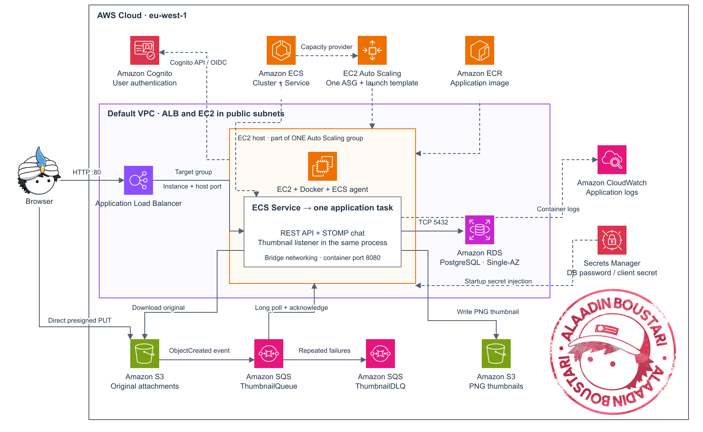

# Deploying SCOK with ECS on EC2

The  setup used **Amazon ECS on self-managed EC2 instances**, **bridge networking**, an **Application Load Balancer**, and **RDS PostgreSQL**.NOt Fargate or ECS Managed Instances.

the ASG maintained **machines** while the ECS Service maintained **tasks**.

## Networking: how the request reached the container

The deployment reused the default VPC and its subnets ( ma kansh fia may gad route tables hhh ) The internet facing ALB and EC2 hosts used public subnets. RDS was reached using its private address inside the VPC

The final task used **bridge** networking

The target group used **Instances** for this bridge setup. The ALB health check used `/login.html`

With bridge networking, the task used the host's networking and SG rules.

## Application flow after deployment

1. A browser reached the ALB, which forwarded HTTP requests and WebSocket upgrades to the application task.
2. Spring Security validated authentication and the app used PostgreSQL for local profiles, rooms, memberships, and messages.
3. For an attachment, the API generated a presigned URL. The browser uploaded the bytes directly to S3, not through the ALB/application server.
4. S3 sent an object-created notification containing the bucket and key to SQS.
5. The Spring Cloud AWS listener received the event, downloaded the image, created a PNG thumbnail, uploaded it to the thumbnail bucket, and updated PostgreSQL.
6. Successful processing allowed acknowledgment/deletion of the SQS message. Repeated failures could move it to the configured DLQ.
