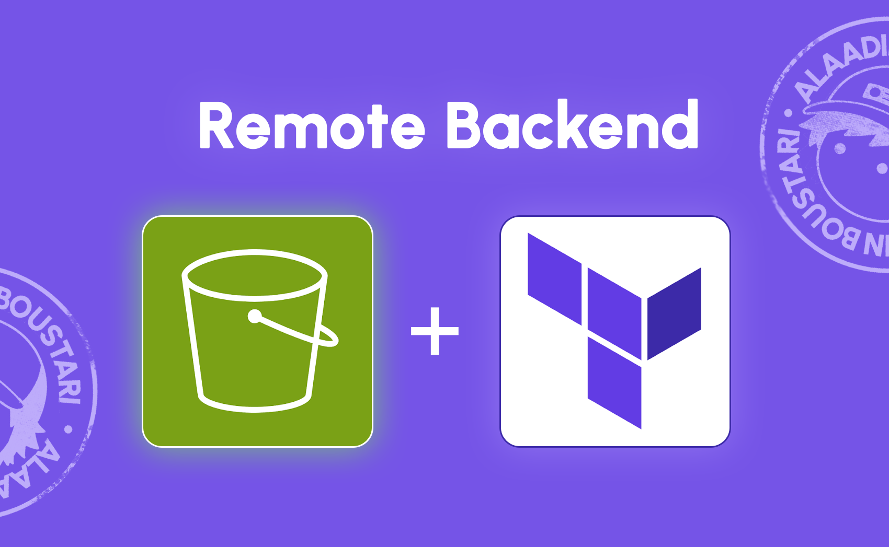

# HashiCorp Terraform: Remote Backend

Clicking around in the console was tedious for this simple project and a week later I already forgot what was running and where I needed to click. In a bigger environment with other people working alongside me this would probably be a nightmare.

The cloud’s solution for this problem is **Terraform**. A declarative infra as code tool to provision your resources using HCL language to define the end state of what you want and they make the API calls for you :D.

## Managing Shared State

While convenient, a very obvious problem will rise and that is shared state conflicts between terraform users. A widely known and **CHEAP** method is to Bootstrap using an S3 bucket with: Versioning + state-Lock + encryption **AND** public access block + lifecycle protection from deletion ( majority are defaults of S3)

This ensures everyone has one source of truth that won’t allow 2 applies to run at the same time or deletion of that Bucket through `terraform destroy`.

## Modular Architecture

The current projects uses a **MODULAR** structure instead of one big `.TF` file. Terraform handles this facilement by drawing a neat Dependency Graph to map out resources and orders of creation.
